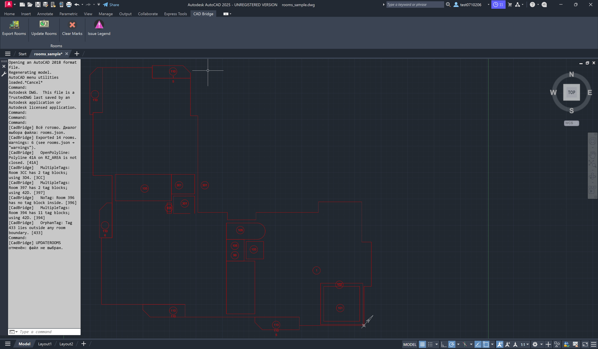
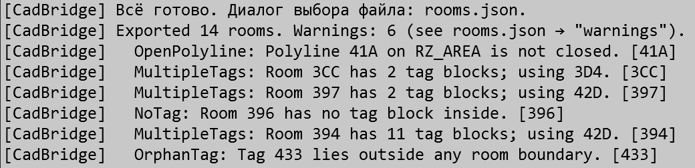
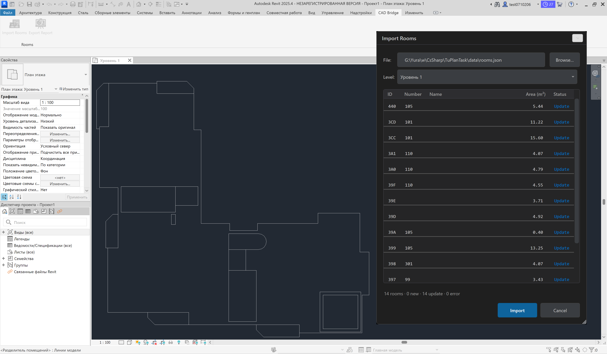
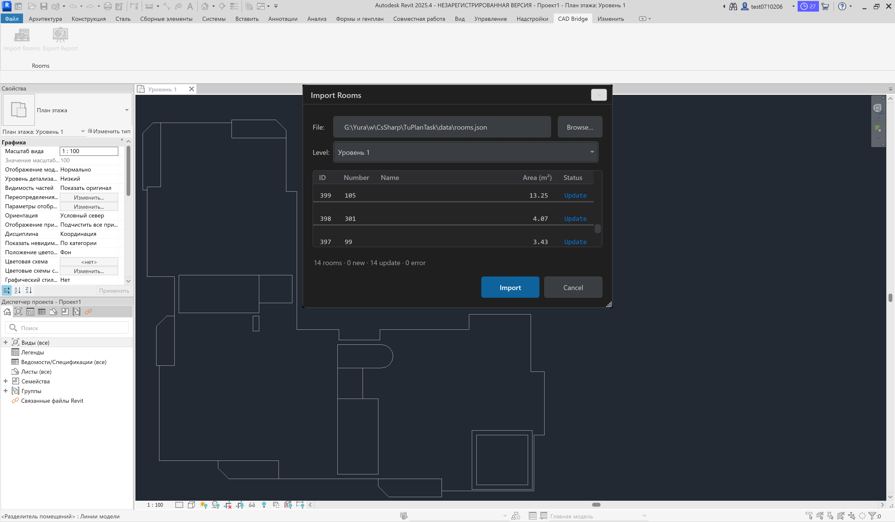
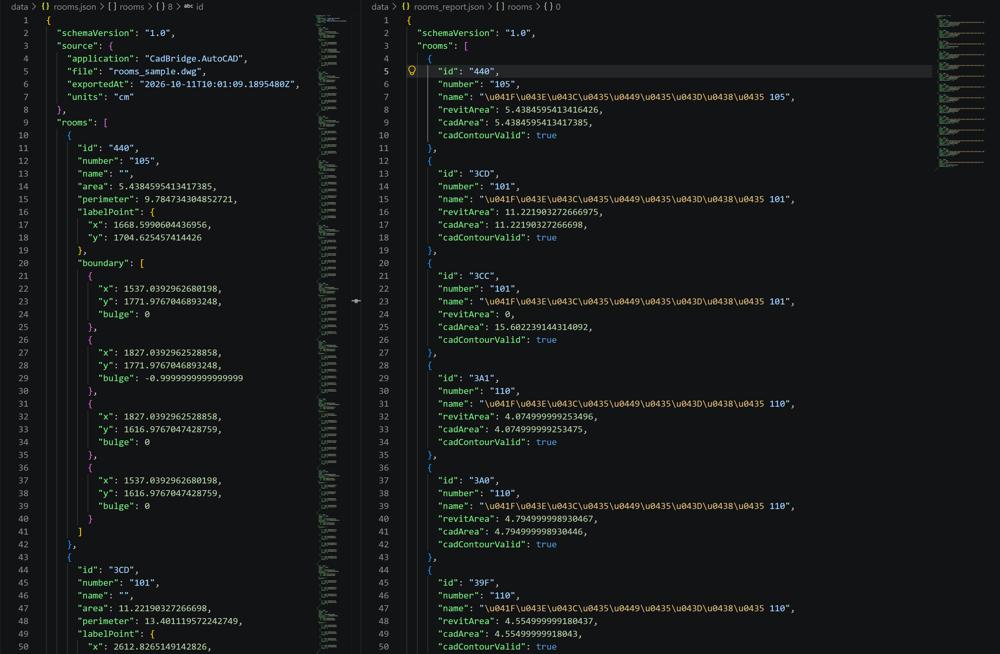
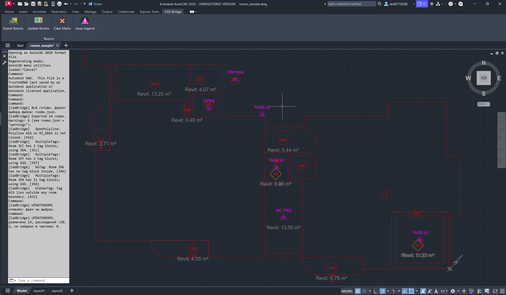
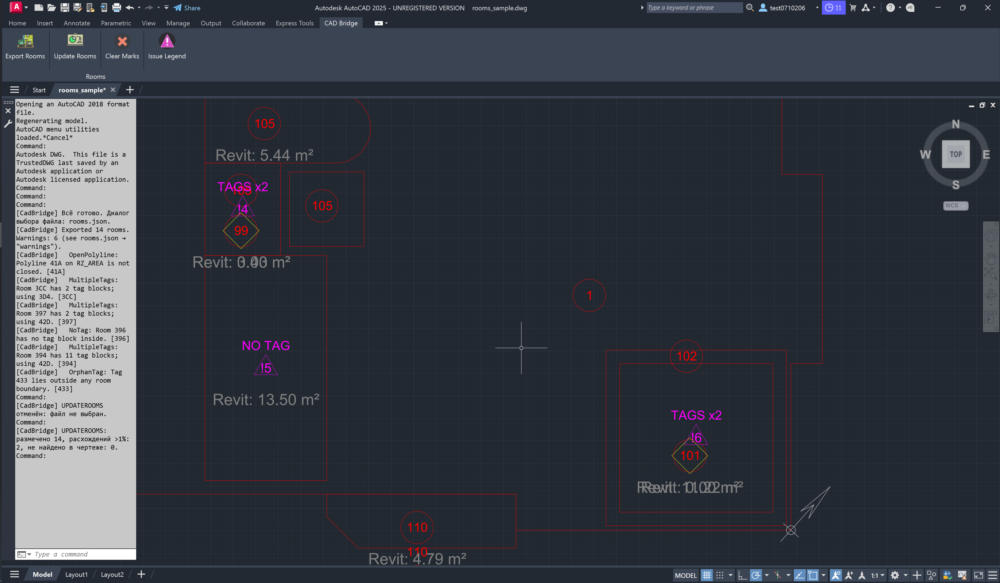
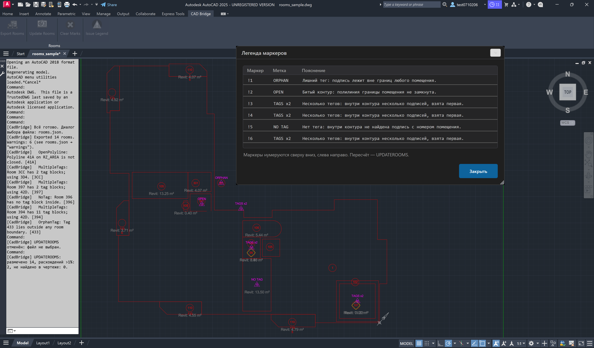

# AutoCAD → Revit Room Bridge (CadBridge)

A small toolchain that **exports rooms from an AutoCAD floor plan to JSON** and **imports them into a Revit model**, plus an optional **reverse loop** that brings computed data back into AutoCAD.

**Role:** .NET Developer (Autodesk AutoCAD / Revit plugins)
**Approx. effort:** ~22 hours (breakdown in §11)
**Platforms:** AutoCAD 2025 + Revit 2025, C#, .NET 8

---

## 1. Overview

Architects often start a project as a 2D plan in AutoCAD and continue in Revit. Room boundaries and their numbers/names are redrawn by hand — slow and error-prone. CadBridge automates that transfer:

```
┌──────────────┐   rooms.json    ┌───────────────┐   rooms_report.json   ┌──────────────┐
│   AutoCAD    │ ──────────────► │     Revit     │ ────────────────────► │   AutoCAD    │
│ EXPORTROOMS  │                 │  Import Rooms │     (optional loop)   │ UPDATEROOMS  │
└──────────────┘                 └───────────────┘                       └──────────────┘
```

Three user-facing entry points:

| Host | Entry point | What it does |
|------|-------------|--------------|
| AutoCAD | Ribbon **CAD Bridge** → *Export Rooms* (`EXPORTROOMS`) | Reads closed `LWPOLYLINE` boundaries on layer `RZ_AREA` + their `RZ_AREA_SYM` tag blocks → writes `rooms.json`. |
| Revit | Ribbon **CAD Bridge** → *Import Rooms* | WPF dialog → preview grid → creates/updates Rooms, separation lines, persistent id, one-step Undo. |
| Revit | Ribbon **CAD Bridge** → *Export Report* | Writes `rooms_report.json` (Revit area + the CAD area captured at first import). |
| AutoCAD | Ribbon **CAD Bridge** → *Update Rooms* (`UPDATEROOMS`) | Reads `rooms_report.json` → draws discrepancy markers + Revit-area labels on layers `A-ROOM-CHECK` / `A-ROOM-ISSUE`. |
| AutoCAD | Ribbon **CAD Bridge** → *Clear Markers* (`CLEARMARKS`) | Removes all CadBridge-drawn markers/text; geometry untouched. |
| AutoCAD | Ribbon **CAD Bridge** → *Issue Legend* (`CADBRIDGELEGEND`) | Modal dialog explaining every numbered `!n` marker drawn on the plan. |

---


## 2. Environment & Target Frameworks

| Item | Choice | Reason |
|------|--------|--------|
| Language | C# 12 (`LangVersion=latest`) | |
| AutoCAD plugin | **.NET 8** (`net8.0-windows`, x64, WPF) | Task allows .NET 8 for AutoCAD 2025+; a single TFM is shared by both hosts. |
| Revit plugin | **.NET 8** (`net8.0-windows`, x64, WPF) | Revit 2025 runs on .NET 8. |
| UI | WPF, MVVM (ViewModel + `RelayCommand`; no third-party MVVM toolkit) | Preferred stack; keeps the dependency surface minimal. |
| Unit tests | xUnit 2.4.2 (+ `Microsoft.NET.Test.Sdk`, `coverlet.collector`) | Standard, fast, CI-friendly. |
| Third-party | `AutoCAD.NET` 25.0.1, `Revit_All_Main_Versions_API_x64` 2025.0.0 — both with `ExcludeAssets="runtime"` | Host-provided assembly stubs are loaded from the host at runtime; copying them locally would conflict. See §9. |

> For AutoCAD 2024 the plugin would need to target **.NET Framework 4.8** instead; this repository targets 2025/.NET 8 as stated.

The solution is four projects:

```
CadBridge.sln
├── CadBridge.Core        // models, JSON, geometry
├── CadBridge.Core.Tests  // xUnit unit tests (also exercises Revit-side pure logic)
├── CadBridge.AutoCAD     // AutoCAD plugin (bundle + ribbon)
└── CadBridge.Revit       // Revit plugin (.addin + ribbon + WPF dialog)
```

`CadBridge.Core` references **no Autodesk assembly** — geometry, matching, units, analysis and JSON live there and are fully unit-tested. Autodesk assemblies are referenced with `Copy Local = false` (`ExcludeAssets="runtime"`). **No Revit/AutoCAD API is ever called from a background thread** — all work happens on the host UI thread inside the command/handler.

---


## 3. Input Drawing Conventions

Room boundaries are **closed lightweight polylines** (`LWPOLYLINE`) on layer `RZ_AREA`. Each room has a **block** (`RZ_AREA_SYM`) on the same layer, inside the boundary, formatted `tag: <USAGE_TYPE> value: <105>`. Drawing units are **centimetres**.

The sample drawing deliberately contains edge cases that must be handled gracefully (never crash, become `warnings`):

- an **open** polyline on `RZ_AREA` → `OPEN_POLYLINE`;
- a room **without a tag block** → `NO_TAG`;
- a room with **two tag blocks** → `MULTIPLE_TAGS` (first block wins, others recorded);
- a tag block **outside any room** → `ORPHAN_TAG`;
- at least one room with an **arc segment** (polyline `bulge`) — handled as geometry, not an error.

> **Assumption (documented per §10):** in the provided sample every valid tag carries only the usage *number* in its attribute (e.g. `105`), and the free *name* attribute is empty. Therefore `rooms.json` records `number` = the tag value and `name` = `""`. The parser accepts both the `tag:/value:` text form and attribute-name fallbacks (`USAGE_TYPE`), so a drawing that also provides a name would populate `name` automatically. The JSON schema (keys/types) is unchanged — only the semantic split of the tag payload is documented here.

---

## 4. Part A — AutoCAD Plugin

### 4.1 Build

```
dotnet build CadBridge.AutoCAD\CadBridge.AutoCAD.csproj -c Debug
```

The project has a `DeployBundle` target that copies the build output into a `.bundle`:

```
%APPDATA%\Autodesk\ApplicationPlugins\CadBridge.bundle\
├── PackageContents.xml
└── Contents\2025\
    ├── CadBridge.AutoCAD.dll
    ├── CadBridge.Core.dll
    ├── CadBridge.AutoCAD.deps.json
    └── CadBridge.AutoCAD.runtimeconfig.json
```

`PackageContents.xml` declares the plugin as an AutoCAD **Application** (`AutodeskProduct="AutoCAD"`, `ProductType="Application"`, `SeriesMin="R25.0"`) with `LoadOnAutoCADStartup="True"` and three global commands: `EXPORTROOMS`, `UPDATEROOMS`, `CLEARMARKS` (plus `CADBRIDGERIBBON`/`CADBRIDGELEGEND` registered from code).

### 4.2 Install

Because it is a bundle, **no `NETLOAD` is required**. Either:

- copy the deployed `CadBridge.bundle` folder into `%APPDATA%\Autodesk\ApplicationPlugins\` (the build does this automatically), or
- use `APPLOAD` → add the bundle for the current session.

On startup the ribbon tab **CAD Bridge** is built automatically when a document is idle.



> **Why a bundle?** A `.bundle` auto-loads on AutoCAD start and is the deployment model Autodesk recommends for .NET Core/.NET 8 plugins, avoiding the manual `NETLOAD` step the task mentions. The `.deps.json`/`runtimeconfig.json` are shipped so the host-resolved .NET 8 runtime loads correctly.


### 4.3 `EXPORTROOMS` behaviour

1. **Selection filter, not a full scan** — `Editor.SelectAll` with a `SelectionFilter` on `LWPOLYLINE` + layer `RZ_AREA` (boundaries) and `INSERT` + block name `RZ_AREA_SYM` + layer (tags). Two targeted queries instead of iterating the whole database.
2. **Block → room matching** by a **custom point-in-polygon** test (see §7): the block's insertion point is tested against each closed boundary; the containing boundary wins.
3. **Per valid room** it computes:
   - **area (m²)** — shoelace over the boundary with the **bulge arc** contribution added (Green's-theorem segment area for each arc edge);
   - **perimeter (m)** — straight edges + **arc length** (`ArcLength = radius · sweep`, where `sweep = 4·atan(bulge)`), because an arc is always longer than its chord;
   - **label point** — the tag block's insertion point when it is inside the room (guaranteed by the same PIP), otherwise a computed interior point (see §7).
4. **Save dialog** → writes `rooms.json` (schema in §6).
5. **Command-line summary**, e.g. `Exported 14 rooms. Warnings: 6 (see rooms.json → "warnings").`

All edge cases from §3.1 surface as warnings and never abort the command; every failure path is caught and reported to the user with a readable message.



---

## 5. Part B — Revit Plugin

### 5.1 Build & install

```
dotnet build CadBridge.Revit\CadBridge.Revit.csproj -c Debug
```

The `DeployAddin` target writes the manifest to `%APPDATA%\Autodesk\Revit\Addins\2025\CadBridge.addin` and points `<Assembly>` at the freshly built DLL. To install manually, copy `CadBridge.addin` into that folder and fix the relative `<Assembly>` path. The manifest registers an `Application` add-in (`CadBridge.Revit.App`) that creates the **CAD Bridge** ribbon tab with **Import Rooms** and **Export Report** buttons.

### 5.2 Import dialog (WPF / MVVM)

`ImportRoomsDialog` is driven by `ImportRoomsViewModel` with `RelayCommand` commands:

- **File** — path to `rooms.json` + **Browse** button;
- **Level** — combo box of all levels in the model;
- **Preview grid** — one row per room: **Number, Name, Area (m²), Status** (`New` / `Update` / `Error`, styled), plus an id column;
- **Import** and **Cancel** buttons (the dialog may be modal).





### 5.3 Import logic

1. **Units** — the file is in cm / m²; `UnitUtils.ConvertToInternalUnits` converts cm → Revit internal **feet** and m² → ft² on the way in; the report converts back with `ConvertFromInternalUnits`.
2. **Per room** (`RevitRoomWriter`, inside one `Transaction` each):
   - builds **room separation lines** that reproduce the boundary — **straight segments** (`Line.CreateBound`) and **arcs** (from the bulge via the mid-point of the arc, `Arc.Create`), on a `SketchPlane` at the level elevation;
   - creates the **Room** at the label point on the selected level (`Document.Create.NewRoom`);
   - sets **Number** and **Name**;
   - stores the **original AutoCAD id** (see §7.5 Extensible Storage) and the **CAD area** captured at first import.
3. **Idempotent** — re-importing the same (or an updated) file **updates** existing rooms matched by the stored source id instead of creating duplicates. Rooms that disappear from the file are **listed in the report, never deleted**.
4. **One Undo step** — the whole batch runs inside a single `TransactionGroup` that is `Assimilate`d, so the entire import collapses into one Revit Undo.
5. **Summary** — a `TaskDialog` shows created / updated / not-updated counts with the reasons for failures.

---

## 6. Part C — Reverse Loop (bonus)

### 6.1 Revit: *Export Report*

Writes `rooms_report.json` for every imported room: **source id, number, name, Revit-computed area, and the CAD area recorded at first import**. Broken contours (open polylines) that never became Revit rooms are appended with `revitArea = 0`, `cadArea = null`, `cadContourValid = false` (via `BrokenRoomProjector`), so the AutoCAD side can still flag them.



### 6.2 AutoCAD: `UPDATEROOMS`

Reads `rooms_report.json` and, for each room matched by handle:

- if the **Revit area differs from the CAD area by more than 1 %** → draws a **yellow diamond** marker at the room's label point on layer **`A-ROOM-CHECK`**;



Additionally, every CAD-side warning (open contour, missing/duplicate tag, orphan) is drawn as a **numbered magenta warning triangle** (`!1…!n`) with a short label on layer **`A-ROOM-ISSUE`**, and the **Issue Legend** dialog explains each marker. Markers and text are tagged with XData and **erase-and-recreate**, so re-running the command **never duplicates** them and stale markers are pruned.



> **Documented deviations from the literal §5.2 text** (allowed by "or another marker"): the discrepancy marker is a **diamond** (not a red circle); the area text is **grey** for contrast; warning triangles live on a separate `A-ROOM-ISSUE` layer. The required layer for discrepancy marking (`A-ROOM-CHECK`) and idempotency are preserved.


---

## 7. Geometry, Design Decisions & Trade-offs

### 7.1 Room identifier — AutoCAD `Handle`

Each room's stable id is the **polyline `Handle`** (`ObjectId.Handle`, DXF group 5, hex). It survives save/re-open of the DWG (the property the task hints is persistent), is never re-used within a drawing, and is regenerated only if the boundary is redrawn from scratch. `ObjectId` is deliberately **not** used — it is session-scoped and changes every time the drawing is opened.

*Trade-off:* if a boundary is erased and redrawn, its handle changes and a re-import creates a new Revit room (the old one is reported as missing). A `GUID` stored via `XDATA`/`XRECORD` would be more robust under heavy editing but is heavier and not required here.

### 7.2 Point-in-polygon — custom implementation

`PointInPolygon` is a **custom even-odd ray-casting** test operating on the flattened boundary (arcs flattened to short chords first). Chosen over the AutoCAD/Revit API because: (a) `CadBridge.Core` must stay **free of Autodesk references** so the logic is unit-testable, and (b) the same algorithm is reused on the Revit side. The task explicitly invites "implement your own or use the API — explain which and why"; this is the "own implementation, shared and tested" choice.

### 7.3 Label point — pole of inaccessibility

`LabelPointResolver` first tries the **arithmetic centroid**; if it is not inside the (possibly concave / arc) boundary, it falls back to an approximate **pole of inaccessibility**: a 64×64 grid over the bounding box keeps the inside point that maximises the distance to the nearest edge (`DistanceToNearestEdge`). This yields a label point that is guaranteed to sit **inside non-convex rooms**, which a naive centroid does not.

### 7.4 Area & perimeter with bulge arcs

`BulgeArc` converts a bulge `b` to a sweep `θ = 4·atan(b)` (so `b = 1` → semicircle, `|b| > 1` → arc larger than a semicircle but < full circle). `AreaCalculator` adds each arc edge's **circular-segment signed area** to the shoelace term, and `ArcLength = radius · θ` to the perimeter — so perimeters of rooms with arcs are correctly **longer** than the chord-only estimate.

### 7.5 Storing the id in Revit — Extensible Storage, not a shared parameter

The source id (and the first-import CAD area) are stored in a **Revit Extensible Storage** `Entity` on the Room (`SourceIdStore`): schema `CadBridgeSourceId`, fixed `SchemaId`, fields `SourceId` and `CadArea`. Chosen over a shared parameter because it requires **no shared-parameter file / project setup** and lives entirely inside the model. Its `SchemaId`/field names are pinned by a unit test (`SourceIdStoreTests`), since changing them would break matching against already-imported models.

### 7.6 The number ⇄ name mapping is a deliberate contract

`TagTextParser` extracts a single payload from each tag and writes it into `number`, leaving `name` empty (§10). This is a **documented, tested contract** (see `TagTextParserTests`): it never silently swaps fields, and a future format that carries an explicit name slot will populate `name` without touching `number`. The JSON schema is unchanged either way — only the field semantics are documented here.

### 7.7 The drawing layer holds only the task-required markers

`A-ROOM-CHECK` receives **exclusively** the >1 % discrepancy markers and their Revit-area labels (the two elements §5.2 requires). Quality warnings are drawn on a **separate** layer, `A-ROOM-ISSUE` (§6), as numbered `!n` warning triangles. This keeps the required layer clean while still surfacing data problems (open contours, missing/duplicate tags, orphans) in a distinct, non-conflicting channel.

---


---

## 8. Build, Deploy & Testing

### 8.1 Build

From the solution root:

```powershell
dotnet build CadBridge.sln -c Release
```

All four projects target `net8.0-windows` / x64. `CadBridge.Core` and the tests build anywhere; the two host plugins additionally need the Autodesk API NuGet packages (restored automatically).

### 8.2 Deploy — Revit plugin

Building `CadBridge.Revit` runs a `DeployAddin` target that copies `CadBridge.dll` and its dependencies to `…\CadBridge.Revit\bin\…` and writes a **`.addin` manifest** into

```
%APPDATA%\Autodesk\Revit\Addins\2025\CadBridge.addin
```

so Revit auto-loads the plugin on next start (Add-Ins → External Tools → the **CAD Bridge** tab appears). The manifest in `data/CadBridge.addin` is a **template with a relative path** — for a fresh clone, re-run the build (which regenerates the deployed `.addin` with the correct absolute path) or copy the template to the `Addins\2025` folder and point `Assembly` at your build output.

### 8.3 Deploy — AutoCAD plugin

Building `CadBridge.AutoCAD` runs a `DeployBundle` target that packs the output into an **ApplicationPlugins bundle** and copies it to

```
%APPDATA%\Autodesk\ApplicationPlugins\CadBridge.bundle
```

AutoCAD auto-loads it on startup — no `NETLOAD` needed. The manifest `PackageContents.xml` must declare `AutodeskProduct="AutoCAD"` and `ProductType="Application"` and place the assemblies under a `Contents\2025\` version sub-folder, exactly as Autodesk's own bundles do; without these AutoCAD silently ignores the bundle. On a clean machine, alternatively `APPLOAD` → add the generated `CadBridge.bundle`.

> Close AutoCAD/Revit before rebuilding if a copy step reports a locked file (`MSB3027`) — the host keeps the DLLs open.

### 8.4 Testing

Pure logic lives in `CadBridge.Core` and is covered by **xUnit** tests that run head-less (no Revit/AutoCAD host required):

```
dotnet test CadBridge.Core.Tests\CadBridge.Core.Tests.csproj
```

| Area | What is covered |
|------|-----------------|
| Geometry | `AreaCalculator` (incl. bulge arcs), `Perimeter`, `PointInPolygon` (convex + concave), `LabelPointResolver` (concave / pole-of-inaccessibility), `BulgeArc` sweep. |
| Units | `UnitConverter` cm→m, m²→ft²→m² round-trips. |
| Matching | handle-based idempotency (`SourceIdStore` GUID handling, `ToGuid` determinism), `SourceIdStoreTests` pins the `SchemaId`/field-name contract so an already-imported model keeps matching. |
| Serialization | JSON round-trips, schema key names, unknown-warning-code fallback. |
| Report / analysis | `BrokenRoomProjector` (open contours → `revitArea=0`), `AreaDelta` 1 % tolerance logic. |

**Total: 161 tests, all green.** The tests deliberately cover not only the happy path but also the task's edge cases (no tag, duplicate tag, orphan, arc geometry).

> Host-bound code (`RevitRoomWriter`, `LayerAudit`, `DwgRoomReader`, `UpdateRoomsUseCase`) is **not** unit-tested here — it needs a live Revit/AutoCAD `Document`. Those paths were verified manually against the sample drawing; to automate them one would extract the pure decisions into `CadBridge.Core` (candidate: room-number assignment, layer/name policy) or drive them from a Revit test framework.

---

## 9. Third-party Packages & Rationale

| Package | Version | Why |
|---------|---------|-----|
| `AutoCAD.NET.Model` (managed + core) | 25.0.1 | Official Autodesk managed API for AutoCAD 2025 (R25). `ExcludeAssets="runtime"` → the host AutoCAD provides the real assemblies at load time; shipping them would clash. |
| `Revit_All_Main_Versions_API_x64` | 2025.0.0 | Official Revit 2025 API. Same `ExcludeAssets="runtime"` rationale — Revit loads `RevitAPI.dll` from its own install. |
| xUnit + `Microsoft.NET.Test.Sdk` + `coverlet.collector` | 2.4.2 / 17.x | Standard .NET test toolchain; no custom harness, runs in CI. |
| WPF (`UseWPF`) | built into SDK | Chosen UI stack per the task (MVVM); no third-party MVVM framework — `RelayCommand` is a ~30-line helper. |

No runtime third-party logic libraries are used. `CadBridge.Core` has **zero** package references — it depends only on the BCL, which is what keeps it portable and testable.


---

## 10. Limitations, Assumptions & Known Behaviour

- **Tag payload split (documented assumption).** In the supplied sample, each valid `RZ_AREA_SYM` block carries only the usage *number* (e.g. `105`) in its attribute; the free-text *name* is empty. CadBridge therefore writes `number = <tag value>`, `name = ""`. The parser also understands the `tag: X value: Y` text form and attribute-name fallbacks (`USAGE_TYPE`), so a drawing that supplies a name populates `name` automatically. The JSON schema is unchanged — only this semantic split is documented.
- **Rooms that Revit cannot bound.** If separation lines self-intersect or a boundary is malformed, Revit may create an *unplaced* room whose `Area` is `0`. CadBridge reports this honestly (`revitArea = 0`), and `UPDATEROOMS` flags it as a >1 % discrepancy. Fixing it is a Revit-side modelling action, not a plugin bug.
- **Discrepancy tolerance is 1 %** as required; because it is relative to the CAD area, very small rooms can show large-looking percentages for sub-centimetre differences.
- **Handle-based id (§7.1):** redrawing a boundary from scratch yields a new id → a new Revit room on the next import; the previous one is listed as missing (never auto-deleted).
- **Marker shapes** are a diamond / warning triangle rather than the literal "red circle" of §5.2 — permitted by "or another marker"; the required `A-ROOM-CHECK` layer and idempotency are preserved.
- **No background threads.** All API access runs on the Revit/AutoCAD main thread inside transactions / command handlers (Revit API requires this).
- **AutoCAD deployment is bundle-based** (auto-load on startup, no `NETLOAD`). On a machine without a prior install, the simplest path is `APPLOAD →` add the `CadBridge.bundle`.

---

*CadBridge — a focused, testable bridge between an AutoCAD plan and a Revit model.*
